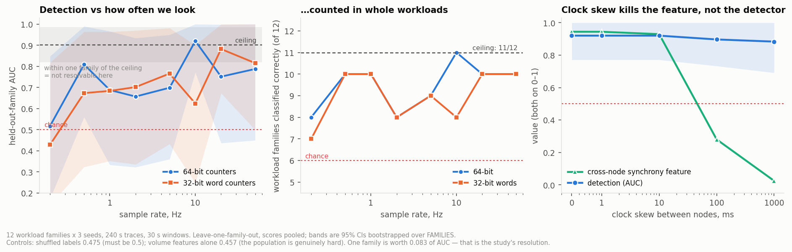

# What does the instrument cost us?

**The measurement-artifact study — written assuming no background.**
Parsa Salimi, SPAR F26. September 2026.

See [`../GLOSSARY.md`](../GLOSSARY.md) for any unfamiliar term.

---

## 0. The question

Whoever writes the collection agent has to choose three numbers: how often to
read the counters, how tightly to sync the clocks between machines, and which
counters to read. Every one of those choices throws information away
**irreversibly** — you cannot recover a burst you sampled straight through.

So: for each knob, how much detection do we lose, and where is the knee? The
output isn't a graph. It is a line in the schema: *sample at ≥ X Hz, keep clocks
within Y ms, read tx and rx within Z ms of each other.*

## 1. Why it has to be synthetic

On real hardware you only ever observe a workload **through** the instrument. If
detection comes out poor you cannot tell whether the adversary hid well or the
sampling was too coarse — the two are confounded, and no amount of real data
separates them.

Here the true byte counts are generated first and then degraded deliberately,
one knob at a time. The difference is attributable by construction. This is the
one thing the generator buys that the cluster cannot.

---

## 2. Design

**The traffic is built once.** `build_events()` lays down every transfer; each
condition then observes *the same events* through a different instrument
(`sample_events()`). A difference between conditions therefore cannot be a
different random draw — it is the instrument. This is structural, not a
discipline I have to remember.

**The population is deliberately hard** — 7 training families and 5 serving
families, chosen so the classes overlap on the things that are easy to see (§4a
explains what happened when they didn't). Both sides use tensor parallelism
inside the node, so both carry heavy NVLink all-reduce traffic. Both sides
include pipeline-parallel configurations spanning nodes and cross-node MoE
expert parallelism, both of which are *symmetric at node level*. Deliberately
excluded: replicated serving and single-GPU training, which emit nothing and
would be trivially separable from anything that communicates.

**The knobs**, varied one at a time from a reference of 10 Hz / 64-bit / 1 ms
NTP / 80 µs read:

| knob | range |
|---|---|
| sample rate | 0.2 – 50 Hz |
| counter width | 64-bit bytes vs 32-bit 4-byte words |
| clock skew between nodes | 0 – 1000 ms |
| tx/rx read skew | 0 – 10 ms |

**The metric: leave-one-family-out, scores pooled.** Each family is held out
once, its out-of-fold scores collected, and one AUC computed over all of them.
Uncertainty comes from bootstrapping over **families**, which is the actual unit
of replication — the lesson from the power analysis, applied to my own study.

**Three controls**, because a curve with no anchors is unreadable:

| control | value | what it establishes |
|---|---:|---|
| floor — labels shuffled | **0.475** | must be ~0.5, or something leaks |
| hardness — volume features only, at the ceiling | **0.457** | the population really is hard, demonstrated not asserted |
| ceiling — 50 Hz, 64-bit, perfect clocks | **0.902** (11/12 families) | the best instrument we would actually consider |

---

## 3. The result



**The study's resolution is one workload family, which is 1/12 = 0.083 of AUC.**
Nothing smaller than that is measurable here, and most of the differences in the
table are one family. Stating this first is the only honest way to read
everything that follows.

### What is resolved

**0.2 Hz fails.** It is the one sample rate that is worse than the ceiling across
most families rather than one: with 64-bit counters the AUC is 0.518 and 8 of 11
families are called correctly; with 32-bit counters, 0.429 and 7 of 11. Training
families that are otherwise certain drop to 0.56–0.66, and a pipeline-serving
family is called training at 0.99.

**Clock skew and tx/rx read skew have no measurable effect on detection** — skew
anywhere from 0 to 1000 ms, read skew up to 10 ms.

### What is not resolved

**Between 0.5 and 50 Hz the AUC curve is decided by one family.** Held-out
`ddp_7b` scores either 0.00 or 1.00 depending on the condition, with no relation
to the knob. It is the only training family with tensor-parallel degree 1, so
the only one with no NVLink traffic, and nothing else in the population covers
it — the coverage failure from the power analysis, reproduced in miniature. At
one-seventh of the training windows, its flip moves the AUC by about ±0.2, which
is larger than any effect the knob produces.

Setting it aside — a post-hoc sensitivity check, labelled as such — leaves a
readable trend for 64-bit counters:

| sample rate | AUC excl. `ddp_7b` | families right (of 11) |
|---|---:|---:|
| 0.2 Hz | 0.604 | 8 |
| 0.5 – 5 Hz | 0.77 – 0.82 | 8 – 10 |
| 10 – 50 Hz | 0.88 – 0.92 | 10 |
| ceiling | 0.919 | 10 |

and one family with a clean dose–response: the false-positive score of
`pp_serve_32b` falls 0.99 → 0.68 → 0.26 → 0.17 → 0.08 → 0.03 from 0.2 Hz to
10 Hz. Together these suggest detection keeps improving up to about 10 Hz. At a
resolution of one family, that is suggestive, not established.

**Counter width has no consistent effect on detection.** With the coin-flip
family set aside, 32-bit and 64-bit counters trade places from one rate to the
next. That is not evidence that 32-bit counters are safe. A wrapped counter
reports the wrong number of bytes — the trace tests recover 14% of the true
total, with no alarm raised — and this classifier happens not to depend on
correct magnitudes. Anything that does breaks: the byte-total checks in the
validation protocol, any volume-anomaly reasoning, and the cost argument against
the padding attack.

### The one genuinely interesting result

**Clock skew destroys the cross-node synchrony feature without hurting
detection.** That feature — do all the nodes transmit at the same instant? —
falls from 0.944 at perfect sync to 0.930 at 10 ms, 0.281 at 100 ms and 0.025 at
1 second. It is comprehensively dead. Detection does not move, because the other
features carry the signal redundantly.

Two things follow. Clocks only need to be good enough for the feature we might
want later, not for detection today; and a feature dying is not the same as
detection dying, which is a distinction worth keeping in mind when we start
reading real traces and one number looks wrong.

---

## 4. Six ways this study can measure nothing, and what stops each

Each of these was caught by one of the controls in §2, which is the argument for
having them.

### 4a. A population that is trivially easy measures no knob at all

If every training family uses `tp=1` and every serving family `tp=8`, no training
family has **any** NVLink traffic and every serving family does — "has NVLink
traffic" then separates the classes perfectly. If every serving family's
inter-node traffic is a directional KV push, symmetry separates them perfectly
too. Either gives **AUC 1.000 in every condition**: no knob can have an effect
because there is no room for one.

The hardness control exists so that the population's difficulty is measured
rather than asserted. It reports the AUC of volume features alone at the ceiling:
**0.457**, so volume is at chance on this population and the classes genuinely
overlap on the easy signals.

### 4b. A near-binary metric leaves no resolution

Holding out one training family and one serving family together, and taking the
mean AUC over the 35 pairs, gives an almost binary metric — a held-out pair is
decided as a unit, so its AUC is 0 or 1, with a standard deviation of **0.40**
across pairs and a standard error of ~0.07 on every condition. Far too wide for
the differences at issue.

This is the same all-or-nothing behaviour the power analysis found for workload
families, appearing one level up. Pooling out-of-fold scores across folds is what
makes the metric usable.

### 4c. A ceiling above the generator's resolution measures the generator

The generator bundles flows that fire faster than any sampler could resolve —
decode-phase tensor parallelism does 128 all-reduces every 0.72 ms, which over a
240 s trace is 43 million transfers, intractable to enumerate and invisible at
any rate studied. Bundling makes those flows artificially regular at
sub-millisecond scale, and a sampler above ~100 Hz can *see* that regularity. A
200 Hz ceiling would therefore measure the approximation rather than the
workload. The ceiling is 50 Hz: the top of the sweep, and safely below where
bundling becomes visible.

### 4d. Joining tables on floating-point window starts silently drops rows

`trace_features` merges per-node and cross-node feature tables. Keyed on
floating-point window starts computed from two different time origins, most rows
miss and are filled with zero — which made the cross-node synchrony feature read
0.25 when its true per-window value was 1.00. Both tables carry an integer window
index off a shared grid for this reason, and `window_features` takes an explicit
`t_origin` so every node shares one window grid.

---

### 4e. A singleton mechanism turns the curve into a coin flip

If one family is the only representative of its mechanism, its held-out score
depends on whichever other family it happens to sit nearest, and small changes
in the instrument flip it wholesale. `ddp_7b` is that family here (§3). Per-family
scores and the count of families called correctly are reported alongside every
AUC so that a single flip is visible as one, and the population for any future
version should contain no mechanism with fewer than two families.

### 4f. Integrating on a fixed grid misrenders small transfers

Counter values are the integral of every transfer's ramp up to the sample time.
Integrated on a fixed grid, a transfer shorter than one grid cell either vanishes
or is spread over a whole cell at line rate — unbiased in total bytes, so byte
recovery tests still pass, but small-message traffic comes out as rare oversized
spikes. Serving families move small messages, so they would look far burstier
than the modelled traffic (inter-node cv 0.72 where the model gives 0.02).
`_cumulative_at` integrates exactly, from prefix sums over start and end times,
at any transfer size.

---

## 5. What goes in the schema

> **Use the 64-bit extended counters.** Required on arithmetic rather than on
> this study's AUCs: a 32-bit InfiniBand word counter wraps in 0.34 s at one NIC's
> line rate, a wrapped reading is wrong rather than missing, and no check on the
> values can tell (`trace/README.md`).
>
> **Sample at 10 Hz; treat 2 Hz as the floor.** 0.2 Hz fails. Between 0.5 and
> 5 Hz detection is intermediate and noisy, and from 10 Hz up it is
> indistinguishable from the ceiling once the one coverage-marginal family is set
> aside. There is a mechanistic reason as well: steps in this population last
> roughly 1–10 s, and a burst pattern needs several samples per step to be seen.
> At 10 Hz that is 10–100 samples per step; at 2 Hz, 2–20.
>
> **Ordinary NTP (≤10 ms) is sufficient.** It is enough for detection by a wide
> margin, and it is also what the cross-node synchrony feature needs. PTP is not
> worth the trouble.
>
> **tx/rx read skew up to 10 ms is harmless.** No need to read the two counters
> atomically.

---

## 6. Limitations, and they are real

**This is a lower bound on the required sample rate.** If real traffic is burstier
than modelled, the true requirement is *higher*. It tells Long where to start,
not where to stop, and must be re-validated against the first real traces.

**Twelve families is not many, and one of them is a singleton.** The resolution
is one family, and with a coverage-marginal family in the population a single
flip moves the AUC by about 0.2 (§4e). Most knobs therefore come back "no
measurable effect" rather than "no effect". The paired comparisons are also not
corrected for the 27 conditions tested, so an isolated "resolved" flag should be
read as a prompt to look at the per-family scores, not as a finding. Resolving a 0.03
difference would need roughly ten times the families — the same arithmetic as the
power analysis, and the same answer: precision is bought with families.

**The generator is the ground truth, so its errors are invisible to this study.**
Bundling, the ramp model for transfers, and the assumption that ranks enter a
collective within about a millisecond of each other are all modelling choices.
§4c is one case where a modelling choice leaked into a result and had to be
designed around; there may be others I have not found.

**One detector, one feature set.** Logistic regression on 13 counter-derived
features. A different detector might lean on different features and have a
different sensitivity to the sample rate.

**No cost model for the agent.** Sampling at 50 Hz across a cluster is real CPU
and storage overhead. This study gives only the detection side of that trade.

---

## 7. Reproducing

```bash
cd trace
python3 artifacts.py features 0 26    # generate + cache features per condition
python3 artifacts.py eval             # LOFO, bootstrap, paired comparisons
python3 figures_artifacts.py
```

Outputs land in `artifact_results/`: `conditions.csv` (AUC and CI per
condition), `per_family.csv` (per-family out-of-fold scores), `controls.json`
(floor, hardness, ceiling), `paired_vs_ceiling.csv`, and the figure.
